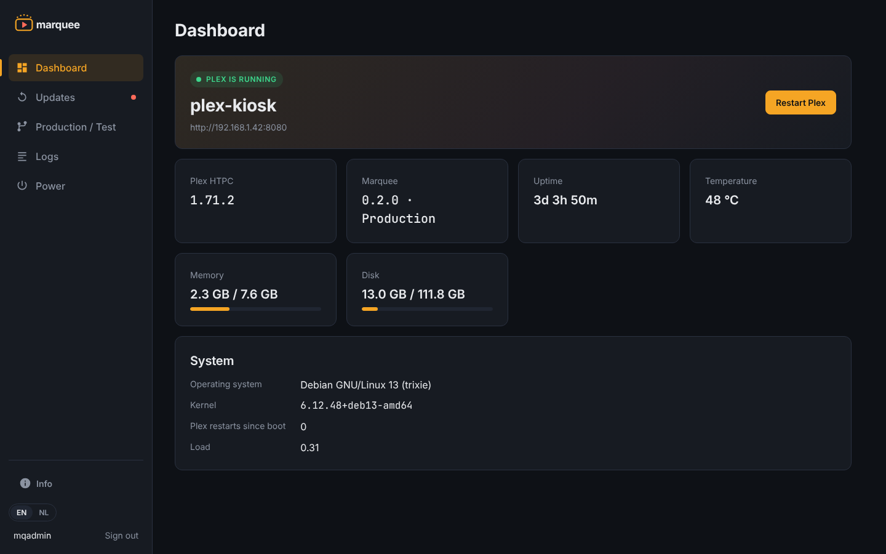

<p align="center"></p>

# Marquee: Debian 13 Plex-kiosk

[English](README.md) · **Nederlands**

Marquee maakt van een gewone x86-pc (Intel of AMD, ook oudere desktops en
mini-pc's) een Plex-apparaat: aanzetten, kort een opstartscherm, en
**Plex HTPC start fullscreen**. Geen bureaublad, geen inlogscherm.

## Wat je krijgt

| | |
|---|---|
| Besturingssysteem | Debian 13 "trixie", minimaal |
| Plex-client | [Plex HTPC](https://flathub.org/apps/tv.plex.PlexHTPC) via Flathub (tv-interface, werkt met afstandsbediening/toetsenbord) |
| Kiosk | [`cage`](https://github.com/cage-kiosk/cage) Wayland-kiosk, gestart door `plex-kiosk.service` op tty1 |
| Zelfherstel | Crasht of sluit Plex, dan start het binnen 3 seconden opnieuw |
| Geluid | PipeWire + WirePlumber (HDMI, analoog, USB) |
| Beeld | Mesa VA-API-drivers voor hardware-decodering op Intel en AMD |
| Updates | Debian: dagelijks via `unattended-upgrades`, herstart om 04:00 alleen als dat nodig is. Plex: elke nacht om 03:30, Plex herstart alleen als er echt een nieuwe versie is |
| Opstarten | GRUB-menu verborgen, Marquee-opstartscherm (Plymouth) |
| Beheer op afstand | Webbeheer op poort 8080, SSH als admin-gebruiker, hulpcommando `plex-kiosk` |
| HDMI-CEC | Werkt met een Pulse-Eight USB-CEC-adapter (de meeste pc-videokaarten hebben geen CEC) |

<p align="center"></p>

## Hardware

- 64-bit x86-processor (Intel Core 4e generatie / AMD Ryzen of nieuwer aangeraden voor 4K/HEVC; ouder werkt prima voor 1080p)
- Minimaal 2 GB RAM, 4 GB aangeraden
- Minimaal 16 GB opslag
- Bekabeld netwerk tijdens de installatie (wifi kan daarna)
- NVIDIA werkt met de open `nouveau`-driver, maar hardware-decodering is beperkt. Intel/AMD hebben de voorkeur.

## Optie A: automatische installer-ISO (aangeraden)

> **Let op:** de automatische optie **wist de eerste interne schijf** zonder te vragen.

1. Bouw de ISO (op een willekeurige Linux-machine met `xorriso` en `curl`):
   ```bash
   git clone https://github.com/rhisijmuiden/plex-kiosk && cd plex-kiosk
   iso/build-iso.sh                       # de installer vraagt één keer het admin-wachtwoord
   # of: iso/build-iso.sh --password --ssh-key ~/.ssh/id_ed25519.pub
   ```
   De ISO komt in `build/marquee-<versie>-amd64.iso`. Bij een release-tag
   (`v*`) maakt GitHub Actions de ISO ook automatisch en hangt hem aan de release.
   Of start *Actions > build > Run workflow* op `main` met een release-tag zoals `v0.3.0`.
2. Zet hem op een USB-stick (balenaEtcher, Rufus in DD-modus, of
   `sudo dd if=build/marquee-*.iso of=/dev/sdX bs=4M status=progress conv=fsync`).
3. Start de pc van de stick. ISO-bootsticks zoals Ventoy of IODD werken ook; USB-schijven worden nooit als installatiedoel gebruikt.
   Na 10 seconden begint de automatische installatie.
   Kies *manual* (BIOS) of een gewone optie (UEFI) voor de normale Debian-installer.
4. Vul het admin-wachtwoord in als daarom gevraagd wordt, wacht 10 à 20 minuten, de pc herstart in Plex.

## Optie B: installatiescript op een bestaande Debian 13

Installeer Debian 13 zonder bureaubladomgeving (alleen "standaard systeemhulpmiddelen"
en "SSH-server") en daarna:

```bash
sudo apt install -y git
git clone https://github.com/rhisijmuiden/plex-kiosk /opt/plex-kiosk
sudo /opt/plex-kiosk/install.sh
sudo reboot
```

## Eerste keer starten

Plex HTPC vraagt één keer om in te loggen (het toont een code die je invult op
<https://plex.tv/link>). Daarna onthoudt het je account.

## Webbeheer

Open `http://<ip-van-apparaat>:8080` (of `http://plex-kiosk.local:8080`) en log
in met het admin-account uit de installer.

<p align="center"></p>

| Menu | Wat het doet |
|---|---|
| Overzicht | Draait Plex, versies, uptime, temperatuur, geheugen, schijf; Plex herstarten |
| Updates | Updates voor Debian, Plex en Marquee controleren en installeren, met live uitvoer |
| Productie / Test | Dit apparaat wisselen tussen de `main`- en `test`-branch |
| Logboek | Kiosk-log van de huidige opstart |
| Aan / uit | Plex herstarten, apparaat herstarten, uitschakelen |
| Info | Versie, kanaal, commit, updatecontrole en "Nu bijwerken" |

Standaard Engels, Nederlands via de EN/NL-schakelaar. Alleen leden van de groep
`sudo` kunnen inloggen. De pagina is gewoon HTTP en bedoeld voor je thuisnetwerk:
zet poort 8080 niet open in je router.

Marquee werkt zichzelf bij vanaf `MARQUEE_REPO` in `/etc/plex-kiosk/plex-kiosk.conf`.
Is de GitHub-repo privé, dan kan het apparaat er niet bij: maak de repo openbaar
of zet een alleen-lezen token in de URL
(`https://<token>@github.com/rhisijmuiden/plex-kiosk.git`). Updates van Debian en
Plex werken in beide gevallen.

## Dagelijks beheer (SSH)

Via SSH (`ssh admin@plex-kiosk.local` of het IP-adres):

| Commando | Doet |
|---|---|
| `plex-kiosk status` | Draait de kiosk? |
| `plex-kiosk restart` | Plex herstarten |
| `plex-kiosk logs` | Kiosk-log van deze opstart |
| `plex-kiosk update` | Debian en Plex nu bijwerken |
| `plex-kiosk version` | Versie van Marquee en Plex |
| `sudo nmtui` | Wifi instellen |

Op het apparaat zelf: `Ctrl+Alt+F2` geeft een inlogprompt, `Ctrl+Alt+F1` gaat terug naar Plex.

Instellingen: `/etc/plex-kiosk/plex-kiosk.conf`.

## Branches

- `main`: productie, dit installeer je op je tv's.
- `test`: nieuwe wijzigingen komen hier eerst.

Apparaat omzetten in het webbeheer onder *Productie / Test*, of via SSH: `sudo marquee-ctl channel test`.

## Huisstijl

Zie [`branding/BRAND.md`](branding/BRAND.md). PNG's opnieuw maken met
`python3 branding/render.py`.

## Problemen oplossen

| Probleem | Oplossing |
|---|---|
| Zwart scherm, geen Plex | `plex-kiosk logs`. Zonder netwerk bij de eerste start wordt Plex op de achtergrond geïnstalleerd; wacht een paar minuten. |
| Geen geluid via HDMI | In Plex HTPC: *Settings > Audio* en kies het HDMI-apparaat. |
| 4K hapert | Controleer hardware-decodering: `vainfo` moet je videokaart tonen. |
| Geen opstartscherm | Sommige oude videokaarten tonen het pas als de driver geladen is; onschuldig. |
